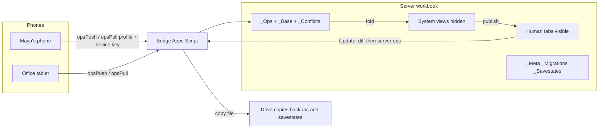
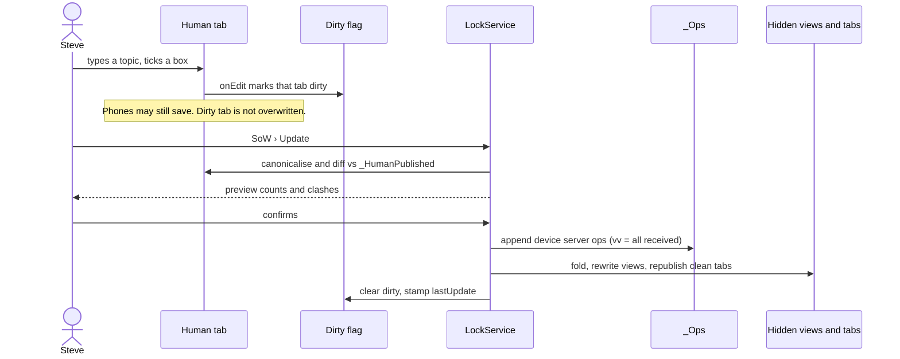
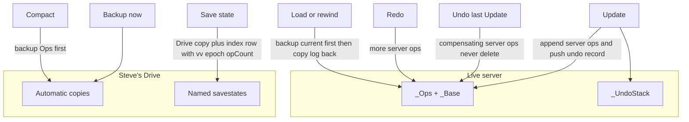
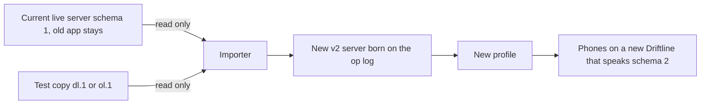
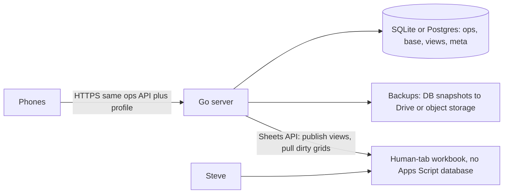

# Server sheet v2 — design and build instructions

Status: **PLAN ONLY.** No sheet, no bridge rewrite, and no app code was built with this document (Steve t257u / t258u, 11 Nov 2026). Quota was tight, so this is the handover the next agent builds from.

Owner: Teacher-S (Steve). Repos: `steph1420/sow-driftline` (this file, branch `feat/rds2`), `steph1420/agent-common` (handover pointer). Companion for Steve: `docs/SHEET_HOW_ITS_BUILT.md` (plain English).

This plan designs a **brand-new** server (a Google spreadsheet) from scratch, plus a rewritten Apps Script bridge. It is not a renovation of the current live workbook. Old data is **imported** into the new server. The current live sheet and the old SoW app v0.47.1 stay untouched.

---

## 1. Purpose and wording

Steve asked for (t257u, t255u, t258u):

1. A fresh server, designed systematically, every tab and column meaningful, ready for later features.
2. Visible **human tabs** in the same spirit as the existing `OLD *` tabs: simple, readable, editable directly in Google Sheets. All system tabs hidden.
3. An **Update** control on human tabs that writes those edits into the database. **Human tabs always win.**
4. A full scheme for Update, backup, restore, savestates (named quick-saves), undo and redo.
5. A rewritten bridge, and a document of how the server is built.
6. An alternative **Option B**: a hosted Go server (Fly.io / Render / Cloud Run, SQLite or Postgres), compared with Option A, with a recommendation and a migration outline. Same op-log rules either way.

**Wording (t255u, use everywhere in new UI and docs):**

| Say | Do not say (in new work) |
|---|---|
| the **server** (the authority that holds the log) | "the sheet" when you mean the authority |
| devices by **their names** (e.g. "Maya's phone") | "the client", "device A" in user-facing text |
| a **profile** (the small file that points an app at this server) | "setup file" |

In the op log, the reserved device id for server / human-tab edits is **`server`**. The current id `sheet` is accepted as an alias (same always-win rule) so a phone that still labels Entry edits `sheet` keeps working.

---

## 2. What must not change (LOCKED)

These already-locked rules apply to **both** Option A and Option B. Do not "improve" them. Sources: `steph1420/agent-common` `08-shared-app-patterns.md` **Q-HARM-10**, `06-coding-standards.md` **rule 9**, and `steph1420/sow` `docs/CRDT_SYNC_PLAN.md` §12–§13. Current bridge contract: `docs/REFERENCE.md` §2.4, §3.5, §3.6 (bridge `0.60.0-ol.1`).

- **Op log, never overwrite.** Every change is an op `{opId = deviceId:seq, deviceId, seq, lamport, vv, kind, target, value, wallAt, recvAt}`. State = `fold(Base + Ops)`. Visible tabs are views, rewritten from the fold.
- **No device clock decides order.** Causal order by Lamport + version vector. `wallAt` is display only. `recvAt` (the server's clock at receipt) is a tiebreak only.
- **True-concurrency rules (unchanged, except the human-Update path in §8 / Q-SV2-1):** ticks are **Set wins** (Developer option: Unset wins / Latest receipt). Left: **server wins**; between two phones, later `recvAt` wins. Phone-vs-phone tick clashes stay Set-wins.
- **Idempotent and gap-safe.** Duplicate `opId` is a `dup`. A seq gap returns `resend`.
- **Conflicts are recorded, never silent.** A true-concurrency clash writes a `Conflicts` row; the app shows them under Sync › Review. Nothing blocks sync.
- **Compaction:** ops older than 60 days fold into `Base` (Drive backup of `Ops` first), except the **current SoW** and the **previous SoW**, which are never compacted. Definition of those runs stays exactly as CRDT_SYNC_PLAN §13 (topic runs, Asia/Calcutta, academic-year start month).
- **Migration of an already-ol.1 workbook:** one click, automatic Drive backup first. After a server is on the op log, old app versions get "update the app" (legacy `push` is refused). This new server is born already on the op log, so there is no in-place "Migrate to op log" on it.
- Tests must replay clock skew (±1 day), offline concurrency, duplicates, gaps, and old-app pushes (coding rule 4).
- Coding rules 1–8 still apply: one data contract, single owner of each piece of state, small modules, tests with code, versioned contract, no magic numbers, small releases, decisions logged. Only Steve locks decisions.

**Human tabs always win** is Steve's new rule for this design (t257u). It tightens the concurrency rule **only** for an Update from a human tab. See §8 and open question **Q-SV2-1**. Until Steve locks it, build to the recommendation in §8.

---

## 3. Design principles (established practice, adapted to this server)

Steve asked for industry-grade database design, adapted for a teacher who edits in Google Sheets. The next agent should treat these as the standard, not invent a new one.

1. **Event sourcing + projections.** The append-only op log is the source of truth. System tables and human tabs are projections (views). No view is authoritative except during the Update handshake in §8, when the human tab is *read as a proposed patch* and then turned into ops.
2. **Stable identifiers.** A session that moves date does not change id. A pupil who changes roll does not lose history. Business labels (roll, date, subject name) are attributes, not keys. See §7.
3. **Schema version and migrations.** `_Meta.schemaVersion` starts at **2**. Every later change is a numbered row in `_Migrations`. Additive (new column, new optional op kind) = minor. Breaking = major, and phones must see a clear "update the app". Never reuse a column letter for a new meaning. Never delete a column in place; hide and stop writing it.
4. **Normalized system tables.** One fact in one place. Names live on `_Pupils`, not copied as source data on every tick row (views may *show* the name).
5. **Soft delete.** A removed session or an inactive subject is an op (`alive` / `subjAct` false), not a deleted row. Compaction may later drop history, never current identity rows still referenced.
6. **Transactional critical sections.** All writes that change the log or views run under `LockService` (script lock, 20 s wait, same as today). An Update is all-or-nothing: append ops, then rebuild views; if a rebuild fails, a repair pass on the next lock recomputes views from the log. Never delete ops to "undo".
7. **3-2-1 style backups.** Named savestates and automatic Drive copies live as separate Google files (another place), plus the live server file. See §9.
8. **Least privilege and no secrets in tabs.** Auth tokens and device key hashes stay in Script Properties, never in a tab, never in git, never in this doc. Pupil names never leave the box in agent logs or commits (house rule). Use demo names only.
9. **Host-agnostic contract.** `opsPull` / `opsPush` (and the fold rules) are the app's API. Option A or Option B can implement them. Do not bake Apps Script types into the app's data layer.

---

## 4. Recommendation up front

**Build Option A now** (a new Google spreadsheet + rewritten Apps Script bridge), and keep the op-log contract host-agnostic so Option B can replace the backend later without inventing a new sync model.

Reasons, in short (full comparison in §12):

- Steve's first-class requirement is **human-editable tabs in Sheets**. That is native in A and extra machinery in B.
- He is not a developer. A has no host to bill, wake, or patch. B needs a cloud account, a card on most hosts, and someone to deploy when it breaks.
- Pupil names already live in his Google account. A keeps them there. B places them on a rented machine.
- Today's pain (Apps Script quotas, reading the whole log, 4 s poll) is real, but compaction, a dirty-flag that skips idle work, and a slightly slower poll when nothing is dirty are enough for one teacher and a few phones. If those limits actually bite after A is live, migrate to B using §12.5.

Do not start Option B unless Steve locks **Q-SV2-4** as B, or later asks for it because A is hitting quotas.

---

## 5. Option A — architecture



- The **server** is one Google spreadsheet. The bridge is bound to it (same `/exec` URL for a given deployment, so phones keep their profile).
- Hidden system tabs hold the log, the metadata, and normalized views.
- Visible human tabs are a published picture of the fold, plus any unsaved typing. Clicking **Update** diffs them, previews, and appends device-`server` ops.
- Phones never write human tabs directly. They only send ops. After a fold, the bridge refreshes human tabs that are **not** dirty.

Locale and timezone stay `en_IN` / `Asia/Kolkata`. Dates on human tabs are `dd/mm/yyyy`. Topics starting `=` or `'` are stored with a leading `'` (plain text), same as today. The script never writes formula columns (it may *create* formulas once when building a view-only tab).

Bridge version for this work: **`0.70.0-sv.1`**. `_Meta.schemaVersion`: **2**. `ping` reports `schema: 2`.

---

## 6. Tab-by-tab schema

Every tab below exists for a reason. If a later feature cannot name the fact it stores, it does not get a column.

Tab names with a `_` prefix are **hidden** (system). All others are **visible**. Do not put a system tab in the visible set "just in case".

### 6.1 Visible human tabs

#### `Server` (status; mostly view-only)

The front door. Steve should be able to see the health of the server without opening hidden tabs.

| Cell / column | Meaning |
|---|---|
| A1 title | `Driftline server` (or the name Steve picks, Q-SV2-9) |
| B2 `Status` | `Saved` / `Unsaved changes` / `Updating…` / `Repair needed` |
| B3 `Last Update` | ISO timestamp of the last successful Update, or `(never)` |
| B4 `Last phone save` | When the last `opsPush` was accepted, plus the **device name** (not an id) |
| B5 `Last backup` | When, and a link |
| B6 `Last savestate` | Name, when, and a link |
| B7 `Schema` | `2` and bridge version |
| B8 `Academic year` | e.g. `2026-27` (start month from `_Meta`) |
| B9 `Conflicts` | Count of unresolved rows (the list itself stays in the app under Sync › Review) |
| B10 `Epoch` | Restore generation (see §9). Phones send this on each call |
| Row 12+ `Devices` | Name · paired · last seen · revoked. **No keys, no hashes.** |

Dirty flag lives here (and in `_Meta`). No free-type data columns except perhaps a note cell. Actions are the SoW menu (and the Update checkbox pattern in §8.2). This tab does not itself need an Update-of-content; changing nothing here writes no ops.

#### `Pupils` (the register — the only place names are edited)

One row per pupil. Modelled on a class register, not on a database dump.

| Col | Header | Type | Meaning |
|---|---|---|---|
| A | Class | text (`KGA`) | Section. Must match a `_Classes` key or a new class is created on Update (preview will say so). |
| B | Roll | whole number | Visible roll. Unique among **Active** pupils in that class. |
| C | Name | text | Display name. Required. |
| D | Status | list `Active` / `Left` | Human-facing Left. |
| E | Left on | date `dd/mm/yyyy` | Filled when Status becomes Left; cleared if they return. |
| F | Note | text | Optional, human only (not an op unless we later add `pupil.note`; v2 stores it on `_Pupils` as an attribute stamped by the Update). |
| G | pupilId | text, hidden column | Stable id. Hidden from casual view (column hidden, not tab hidden). Filled by the builder / Update if blank. Never edited by hand. |

Header row 1 frozen. Row 2 may hold a short hint (`Edit names here. Then SoW › Update.`). Adding a row adds a pupil on Update. Clearing a name of an existing pupil is refused in the preview (use Left, do not delete history). Changing Class or Roll of an existing `pupilId` is a move, not a new pupil.

**Recommendation (Q-SV2-6):** subject tabs show names read-only, so two tabs cannot disagree about a spelling.

#### `Plan` (the scheme of work, list form)

One row per session. This is the comfortable place to type dates and topics in bulk, add a date, or drop a date.

| Col | Header | Type | Meaning |
|---|---|---|---|
| A | Date | date `dd/mm/yyyy` | The session's current date (a move changes this, not the id). |
| B | Class | text | |
| C | Subject | text (`Eng`) | |
| D | Kind | list `CW` / `HW` | |
| E | Topic | text, ≤ 200 | |
| F | Status | list `Open` / `Completed` | Optional; default Open. |
| G | sessionId | text, hidden column | Stable id. Blank on a new row; assigned on Update. |

A new row with Date + Class + Subject + Kind adds a session (`session.add`). Deleting the row (or an `Alive` checkbox in a hidden column set false) is `session.remove`. Changing Date is `session.date`. Changing Topic is `session.topic`. A date that the same subject already has is refused with the existing text: `"<to> already has a session — <from> not moved"`.

#### One tab per subject, named like the OLD tabs: `KGA Eng CW`

This is the layout Steve asked to keep. It is a **wide register**: pupils down the side, dates across the top, checkboxes in the grid, topic in the header — the same shape as `OLD KGA Eng CW` (REFERENCE §2.1), but not limited to two date columns.

Recommended layout (row numbers are fixed; the builder refuses to publish if Steve has inserted rows above the header — see edge cases):

| Area | Cells | Meaning |
|---|---|---|
| A1 | Subject title | `KGA Eng CW` (must match the tab name / subjectKey). Read-only. |
| C1 | Year | Academic year label, or a Year cell Steve can change to look at an older year (Q-SV2-2). Changing Year is a view filter, not an op, until he edits and Updates that year's cells. |
| A2 | Banner | `Saved` or `Unsaved changes — SoW › Update`. Written by the script, not typed. |
| C2 onward, row 2 | Dates | One column per session of this subject in the visible year, `dd/mm/yyyy`. Steve may edit a date (move), type a new date in the first empty column (add), or clear a date (remove, after preview). |
| C3 onward, row 3 | Topics | Topic for that date. |
| A4 / B4 | headers | `Roll` / `Name` |
| C4 onward | (blank or a thin rule) | Not a data row. |
| A5+ | Roll | From `_Pupils` for this class. |
| B5+ | Name | Display only (Q-SV2-6). |
| C5+ | Tick | Checkbox. TRUE = Set, FALSE = not set. Blank is treated as FALSE. |
| Last used column + 1, row 2 | hint | `(type a date to add)` |

Columns A–B frozen. Left pupils go in a short block below a blank row and a `Left` label, still with their ticks (history is kept). They are not mixed into the Active list.

**Date window (Q-SV2-2, recommendation):** show every session in the **current academic year** for that subject. A twice-weekly class is ~80 columns — usable with a frozen name column. Older years appear when Steve changes the Year cell. Do not dump five years into one grid.

Marks (the time a tick was marked, back-dated flag) are **not** on this grid. They stay a phone/server concern (`tick.mark` ops, `_Marks` view). Putting times into the wide grid would ruin the OLD-tab simplicity. A later human tab can be added if Steve asks to edit marks by hand.

#### `Overview` (view-only)

A readable snapshot of the current SoW, in the spirit of today's Dashboard: Date, Subject, Topic, Active, Set, Set %, Not set, Names not set. Built from formulas over the hidden views, or rewritten on each fold. **No Update button** — there is nothing to consolidate. Hidden helper columns are allowed only if each is named and documented in the builder; prefer no hidden columns here.

No other visible tabs in v2. Conflicts stay hidden (reviewed in the app). Savestates are listed on `Server` and in the menu, not as a spreadsheet Steve has to edit.

### 6.2 Hidden system tabs

All columns plain text unless noted. Row 1 is a frozen header. The script writes data columns only.

#### `_Meta` (key · value)

| key | Meaning |
|---|---|
| `schemaVersion` | `2` |
| `academicYearStartMonth` | `4` (April), already the SoW default |
| `academicYearLabel` | `2026-27` |
| `builtAt` | When the empty server was created |
| `importedAt` / `importedFrom` | Import stamp and source workbook id (never a token) |
| `lastPush` | Last accepted write (Update or `opsPush`) |
| `lastUpdate` | Last human Update |
| `dirty` | JSON `{tabs:[…], at, by}` or empty |
| `humanRev` | Revision of the last published human-tab snapshot |
| `oplogFloor` | JSON vv of compacted ops |
| `tickConflict` | `set` (default) / `unset` / `latest` — same Developer hook as ol.1; no app UI |
| `lastCompaction` | Count + backup URL |
| `epoch` | Integer, starts at 1; bumped on a rewind restore (§9) |
| `lastBackup` / `lastSavestate` | URL + time + name |
| `locale` / `timeZone` | `en_IN` / `Asia/Kolkata` |
| `profileMadeAt` | When a profile was last made (replaces `setupFileMadeAt`) |

No tokens, no device keys.

#### `_Migrations`

| Col | Meaning |
|---|---|
| A `id` | `2.0.0`, then `2.1.0`, … |
| B `appliedAt` | ISO |
| C `fromVer` / D `toVer` | |
| E `notes` | Short, no pupil names |

The builder writes `2.0.0` when it creates the server. Later schema steps only run if the row is absent, and always backup first.

#### `_Ops` (append-only log)

Same contract as ol.1 `Ops`, new name with the `_` prefix so it sorts with system tabs.

| Col | Meaning |
|---|---|
| A `opId` | `deviceId:seq` |
| B `deviceId` | `server`, `base`, or a phone's id (`d` plus 6–40 lowercase letters/digits). Alias `sheet` = `server`. |
| C `seq` | Per-device, 1, 2, 3… |
| D `lamport` | |
| E `vv` | JSON `{deviceId: lastSeqSeen}` |
| F `kind` | See §7.2 |
| G `target` | |
| H `value` | JSON |
| I `wallAt` | Display only |
| J `recvAt` | Server clock, strictly increasing |
| K `status` | empty counts · `refused` kept so seq has no gap · `alias:<sid>` · `undone` (the original is still here; a later compensating op is what changes state) |

Never update a counted op in place. Never delete a row to undo.

#### `_Base`

Same as ol.1 `Base`: one row per register after migrate-from-old-data or after compaction.

| Col | Meaning |
|---|---|
| A `register` | `field:target` |
| B `value` | JSON |
| C–J | opId, deviceId, seq, lamport, vv, recvAt, wallAt, by — the op that last set this register when it was folded in |

#### `_Conflicts`

Same as ol.1, plus the device **name** when known (for humans reading a debug export). The app still keys by op ids.

| Col | Meaning |
|---|---|
| A `at` | recvAt of the decision |
| B `register` | |
| C `rule` | `set-wins` / `server-wins` / `recvAt` / `keep-wins` / … |
| D–F | win value, win deviceId, win opId |
| G–I | lose value, lose deviceId, lose opId |
| J `winName` | Device name or `server` (optional, denormalised for reading) |

#### `_Classes`

| Col | Meaning |
|---|---|
| A `classKey` | `KGA` — stable key |
| B `label` | Display (`KG A`) if ever different; default = classKey |
| C `order` | Number |
| D `active` | TRUE/FALSE |
| E `createdAt` | |

#### `_Subjects`

| Col | Meaning |
|---|---|
| A `subjectKey` | `KGA_Eng_CW` — stable |
| B `classKey` | |
| C `subject` | `Eng` |
| D `kind` | `CW` / `HW` |
| E `active` | |
| F `order` | |
| G `createdAt` | |

A new subject on Update also creates its human tab. Unticking Active hides that human tab (does not delete it). **Remove a subject** stays off as a destructive menu, same as ol.1 after Migrate; Steve unticks Active.

#### `_Pupils`

| Col | Meaning |
|---|---|
| A `pupilId` | Stable, see §7.1 |
| B `classKey` | |
| C `roll` | |
| D `name` | |
| E `status` | `Active` / `Left` |
| F `leftOn` | `yyyy-mm-dd` or empty |
| G `note` | |
| H `updatedRecvAt` | Of the last op or Update that changed this row |
| I `createdAt` | |

#### `_Sessions`

| Col | Meaning |
|---|---|
| A `sessionId` | Stable, see §7.1 |
| B `subjectKey` | |
| C `classKey` | |
| D `date` | `yyyy-mm-dd` (current date; moves do not change A) |
| E `topic` | |
| F `status` | `Open` / `Completed` |
| G `alive` | TRUE/FALSE |
| H `createdAt` | |
| I `updatedRecvAt` | |

On this view a teacher looking over Steve's shoulder still sees one row per date. The bridge may also expose a *display id* `subjectKey|date` for old `pull` compatibility (REFERENCE §2.4).

#### `_Ticks`

| Col | Meaning |
|---|---|
| A `tickId` | `sessionId|pupilId` |
| B `sessionId` | |
| C `subjectKey` | |
| D `pupilId` | |
| E `roll` | Denormalised for old `pull` and for human-tab writes (the join is pupilId) |
| F `set` | TRUE/FALSE |
| G `updatedRecvAt` | |
| H `by` | Store deviceId; views may show the name. |
| I `subManual` | Kept from today's Ticks!J (Submitted by hand). Migration-only register `sub:` until an op kind is added. |

No formula column like today's Ticks!I (pupilStatus). Compute Left from `_Pupils` when publishing human tabs. Formulas that the script must not touch were a foot-gun; this view is script-owned.

#### `_Marks`

Same role as ol.1 `Marks`: one row per marked tick. Newer fold wins. Empty `markedAt` is a tombstone (a clear).

| Col | Meaning |
|---|---|
| A `tickId` | |
| B `sessionId` | |
| C `markedAt` | ISO or empty |
| D `backDated` | TRUE/FALSE |
| E `updatedRecvAt` | |
| F `deviceId` | |

#### `_Prefs`

Unchanged from today (key, category, value JSON, updatedAt, deviceId) until a later phase moves prefs onto the op log (CRDT_SYNC_PLAN §6, **Q-SV2-8**). Hidden. Keys matching token, bridge, or URL secrets, and a short list of device-local prefs, are still never stored (same deny-list as REFERENCE §2.2).

#### `_HumanPublished`

Dirty detection snapshot. One row per human tab that can be Updated (`Pupils`, `Plan`, each subject tab).

| Col | Meaning |
|---|---|
| A `tab` | Tab name |
| B `rev` | Integer |
| C `publishedAt` | |
| D `hash` | Hash of the canonicalised used range (values only, not formatting) |
| E `snapshot` | JSON of the canonical grid (or a pointer to a named range / a hidden sidecar tab if JSON would be huge). Must be enough to diff. |

#### `_Savestates`

Index only. The bytes live in a Drive copy.

| Col | Meaning |
|---|---|
| A `id` | `s` + short id |
| B `name` | What Steve typed (`Before parents evening`) |
| C `kind` | `named` / `auto` / `pre-restore` / `pre-compact` / `pre-import` |
| D `at` | ISO |
| E `url` | Drive URL of the copy |
| F `fileId` | |
| G `epoch` | Epoch at the moment of the save |
| H `vv` | JSON vv (op-log position) |
| I `lamport` | |
| J `opCount` | |
| K `note` | Optional |

#### `_UndoStack`

| Col | Meaning |
|---|---|
| A `id` | |
| B `at` | |
| C `label` | e.g. `Update (12 ticks, 1 topic)` |
| D `epoch` | |
| E `undoOpIds` | JSON list of the compensating opIds written for Undo (filled when undone) |
| F `forwardOps` | JSON: the server ops this Update (or action) appended — enough to build compensating and redo ops |
| G `state` | `done` / `undone` |

Keep the last **20** Update batches (and server-side undo/redo actions). A new Update after an undo **clears the redo tail** (standard editor rule). Compaction does not remove this stack; compensating ops are new ops and do not need the original rows to still be in `_Ops` (the value to restore is stored in `forwardOps`).

Script Properties (unchanged roles): `SOW_TOKEN`, `SOW_PAIR`, `SOW_DEVICES` (hashes only), plus `SOW_EPOCH` (mirror of `_Meta.epoch`), `SOW_SERVER_SEQ` (the `server` device seq counter). No tombstone property is needed for new work (removals are ops); do not import `SOW_TOMBS` into a fresh server except as already-applied removes in Base.

---

## 7. Identifiers and op kinds

### 7.1 Stable ids

| Id | Form | Rules |
|---|---|---|
| `classKey` | `KGA` | Stable. A rename is a later feature (`class.rename`); not in v2. |
| `subjectKey` | `CLASS_Subject_KIND` e.g. `KGA_Eng_CW` | Stable. Matches today's keys so import is 1:1. |
| `pupilId` | Assigned once: `p:` + `classKey` + `|` + roll at first insert, e.g. `p:KGA|19`. If that string is already used (roll reuse in a later year), suffix `~` + short id. | **Never changes** if the pupil changes roll or class. (classKey, roll) is unique among **Active** pupils. Left pupils may keep their old roll. **Q-SV2-3.** |
| `sessionId` | Same as ol.1: `subjectKey|yyyy-mm-dd` of the **first** date, with a `+` / `~…` suffix if that id was already used. | Date is a register. A move does not change the id. |
| `tickId` | `sessionId|pupilId` | Not keyed by roll, so a roll change does not break ticks. Old `pull` can still emit `sessionId|roll` for beta.18 if a compatibility shim is kept (phase 6). |
| `opId` | `deviceId:seq` | Unchanged. |
| `deviceId` | `d` plus 6–40 lowercase letters or digits for phones; reserved: `server`, `sheet` (alias), `base`. | A phone may only send its own ops. |

### 7.2 Op kinds (v2)

The ol.1 set stays. One additive kind for notes is optional and can wait.

| Kind | target | value | Registers | Concurrency (true ties) |
|---|---|---|---|---|
| `tick.set` | `sid|pupilId` | true/false | `tick:` | Set wins, **except** a human Update: server wins (Q-SV2-1) |
| `tick.mark` | `sid|pupilId` | `{at,back}` or null | `mark:` | later recvAt; human Update: server wins if the Update touched marks (v2 grid does not) |
| `session.add` | sid | `{subjectKey,classKey,date,topic?}` | `alive:` true, `meta:`, `date:`, `topic:` | alive: keep wins |
| `session.remove` | sid | null | `alive:` false | keep wins |
| `session.date` | sid | `yyyy-mm-dd` | `date:` | later recvAt; human Update: server wins |
| `session.topic` | sid | text ≤ 200 | `topic:` | later recvAt; human Update: server wins |
| `left.set` | `pupilId` (not `classKey|roll`) | `Left`/`Active` plus optional `leftOn` | `left:` | **server wins**; phone vs phone: later recvAt |
| `pupil.add` | pupilId | `{classKey,roll,name}` | `pupil:` | later recvAt; human Update: server wins |
| `pupil.move` | pupilId | `{classKey,roll}` | `pupilKey:` | server wins on Update; else later recvAt |
| `pupil.name` | pupilId | text | `name:` | server wins on Update; else later recvAt |
| `subject.add` | subjectKey | `{classKey,subject,kind,order}` | `subj:`, `subjAct:` true | later recvAt |
| `subject.active` | subjectKey | true/false | `subjAct:` | later recvAt |

`left.set`'s target changes from `classKey|roll` to `pupilId`. The importer maps old Left rows onto `pupilId`s it just created. Phones on a v2 contract send `pupilId`; a compatibility shim may accept the old target during phase 6 only.

Names and new pupils are **ops** in v2 (today, names are hand-typed on Roster and are not ops). That is required for "Update consolidates the register" and for Option B later. Until phones learn `pupil.*` kinds, only the server writes them.

---

## 8. Human tabs: dirty, diff, preview, Update, lock, always-win



### 8.1 Dirty detection

- An installable `onEdit` (and `onChange` for structure, if available) watches only the human edit tabs: `Pupils`, `Plan`, each subject tab.
- Edits to the banner, the Year filter, or script-written cells do **not** mark dirty.
- `_Meta.dirty` lists dirty tab names and the first edit time. `Server!B2` and the tab's A2 banner show `Unsaved changes`.
- A content hash of the canonical used range, compared with `_HumanPublished`, is the source of truth when the menu is clicked (so a missed onEdit still works; a hash match means Update is a no-op).
- Canonicalisation before hash and diff: trim names, coerce checkboxes to boolean, dates to `yyyy-mm-dd`, treat blank tick as false, ignore purely cosmetic format changes.

While a tab is dirty, the bridge **must not** rewrite that tab when phones save (it would wipe unsaved typing). Other, clean human tabs may refresh. The `Server` banner should add a line like: `Maya's phone saved 4 changes. They will show after you Update. Your unsaved edits win if they clash.`

Offer **SoW › Discard unsaved changes** (republish that tab from the fold) and **SoW › Reload this tab**.

### 8.2 The Update control

Google drawings used as buttons break when a tab is rebuilt. Do not rely on them.

Provide all of:

1. Menu **`SoW › Update`** (primary). Works from any tab. Updates every dirty human tab in one lock (one batch, one undo record).
2. A checkbox on each editable human tab, e.g. cell `E1` labelled `Update now`, watched by `onEdit`. Ticking it runs the same function and then unticks itself. Cheap and rebuild-safe.
3. Optional: a drawing only as decoration, not as the only trigger.

`onOpen` builds the SoW menu listed in §11.

### 8.3 Diff, preview, locking

Under the script lock (20 s wait; if not acquired, tell Steve to try again — never write without the lock):

1. Re-read all dirty (and, for safety, all updatable) human tabs.
2. Diff against `_HumanPublished` and against the current fold (they should match except for Steve's edits and any phone ops received while dirty). Produce a patch: new/changed/cleared ticks, topic/date changes, adds/removes, Left, pupil adds/moves/renames.
3. Validate: known or new subjects; rolls whole numbers; no two Active pupils in a class with the same roll; dates real; topic length; date collisions; no deleting a pupil (Left only); Year cell not mid-edit.
4. Count clashes with ops received while dirty (the values the phones saved that the human grid is about to overwrite).
5. Show a **preview dialog**: e.g. `12 ticks, 1 topic, 1 Left will be saved. 2 of those overwrite changes already received from Maya's phone. Pupils: no name changes.` Invalid rows are listed and **excluded**, not silently dropped. Steve confirms or cancels.
6. On confirm: allocate `server` seqs under the same lock, set `vv` to **everything the server has received**, `wallAt` = now, `recvAt` = strictly increasing server clock, append ops, fold, rewrite hidden views, republish **all** human tabs (clean), write `_HumanPublished`, clear dirty, append an `_UndoStack` row, stamp `_Meta`.
7. On cancel: release the lock, leave dirty as-is.

If the script is close to the 6-minute cap, refuse to start and ask Steve to Update one tab at a time (menu: **Update this tab only**). Design the fold/publish to be incremental (only rewrite changed subject tabs) so a normal morning Update stays well under a minute.

### 8.4 Human tabs always win (Q-SV2-1, recommendation)

An Update writes device-`server` ops whose `vv` includes every op already received, so they are **after** everything already on the server.

Phone ops that **had not arrived yet** (offline, or in flight) are still concurrent with those server ops when they later arrive. For that case Steve's rule is: **the human tab wins**.

**Recommended lock:**

- For every register **touched by that Update**, a concurrent later arrival from a phone loses to the `server` op. Rule name in Conflicts: `server-wins`. The phone's op is kept (seq stays whole) but does not count. A Conflicts row is always written.
- For registers **not** touched by that Update, the ordinary rules apply (Set-wins on ticks, and so on).
- Phone vs phone, and phone vs an older server op that was *not* from this "always win" path, are unchanged: ticks Set-wins, Left server-wins, dates/topics later recvAt.
- Entry-like typing on a human tab that has not been Updated is **not** yet an op. Only Update (or a discarded dirty state) changes the log.

This tightens Q-CRDT-2 only on the human-Update path. It must be logged as a decision when Steve locks it. Until then, implement the recommendation and list it as open.

### 8.5 Phones saving at the same time

- `opsPush` / `opsPull` wait on the same script lock as Update. A phone may time out and retry; retries are idempotent by `opId`.
- After Update, the next `opsPull` returns the new `server` ops. The phone folds them and its views match.
- If the phone still has unsent ops that clash, they are sent, recorded, and lose on the registers the Update touched (above). The phone should surface the conflict in Sync › Review.

---

## 9. Backup, restore, savestates, undo, redo, retention



### 9.1 Backup (Drive copy)

- **SoW › Backup now** makes a full spreadsheet copy (`ss.copy`, same as ol.1 — no extra Drive scope): `Driftline server backup · yyyy-mm-dd HHMM`.
- Automatic copies, always **before**: compact, import, schema migration, restore / load savestate, and a first build. Not before every Update (too many files).
- The copy is an ordinary spreadsheet Steve can open. `_Savestates` (or `_Meta.lastBackup`) stores the URL. The live `/exec` URL and Script Properties stay on the live file; a copy is data, not a second server, until someone deploys a bridge on it (they should not).

### 9.2 Savestates (named quick-saves)

Like a game save: a named snapshot plus the **op-log position**.

- **SoW › Save state…** asks for a name, then does a Drive copy (`Driftline save · <name> · yyyy-mm-dd`) and appends a `_Savestates` row: name, time, url, epoch, vv, lamport, opCount.
- That row is the pointer into the log (the vv / opCount). The Drive copy is the bytes to load, including human tabs as they were.
- Named saves are never auto-deleted. Steve can rename or delete from the menu (delete = trash the copy and mark the row, not a secret wipe).

### 9.3 Restore and load

Always **backup the current server first** (`kind = pre-restore`).

Two modes (**Q-SV2-7**, both recommended):

| Mode | Menu | What happens to the log | What happens on phones |
|---|---|---|---|
| **Load save (keep unsaved phone work)** | `SoW › Load state…` | Replace `_Base` / `_Ops` / views / human tabs with the savestate. **Epoch unchanged.** | Phones already in sync rewind on the next pull (they drop acked ops not in the new log and fold again). **Unsent** ops are then pushed and apply **on top of** the loaded state (ordinary rules; Steve can Update afterwards to win). |
| **Rewind to save (phones drop unsaved work)** | `SoW › Rewind to state…` | Same replace, then **`epoch = epoch + 1`**. | `opsPush` / `opsPull` with the old epoch returns `{ ok:false, error:'restored', epoch, resync:true, base, ops }`. The phone **discards unsent ops**, stores the new epoch, and folds the restored log. Use this when Steve really means "go back." |

**Restore from backup** is the same pair of modes, picking an automatic copy instead of a named save.

Do not swap the live file for the copy (that would change the spreadsheet id and break profiles). Copy values **into** the live workbook. Script Properties except epoch stay. After a rewind, write `SOW_EPOCH`.

Preview before either mode: name of the save, when, opCount, and a warning about phones.

### 9.4 Undo and redo (compensating ops, never delete)

This is the **server** undo (the SoW menu), not the phone's 60-step undo, which stays as it is (the phone already writes new ops).

- **SoW › Undo last Update** writes a batch of device-`server` ops that set each touched register back to the value before that Update (`forwardOps` on `_UndoStack` has both sides). The original ops stay in `_Ops`. The new ops have a normal seq, a `vv` of everything received, and win like any other server Update (same always-win rule, so a phone cannot sneak past an undo).
- **SoW › Redo** writes another batch that reapplies the Update's values.
- A new Update (or a restore) clears the redo tail.
- Undo is refused if the stack is empty, if `epoch` no longer matches the record, or similar. Always preview: `Undo "Update (12 ticks, 1 topic)"?`.
- Never delete a row on `_Ops`. Status `undone` on the stack row is bookkeeping, not history rewriting.

The phone's Undo remains a local UX that pushes ordinary ops. It does not pop the server stack.

### 9.5 Retention

| Thing | Keep |
|---|---|
| Named savestates | Until Steve deletes them |
| Automatic backups | Last **14** `auto` / `pre-*` copies; older ones go to Drive trash (and the index row is marked). Tell Steve in the compact/backup toast if a file was trashed. |
| `_Ops` | 60 days, except current and previous SoW (LOCKED). Backup `_Ops` before compact, same as ol.1. |
| `_Conflicts` | All (they are small). A later trim can keep 1 year; not needed in v2.0. |
| `_UndoStack` | Last **20** batches |
| Prefs, devices | No time trim in v2 |

Vector clocks still do not drop devices unseen for 60 days (known ol.1 limit). A later minor can add it (CRDT_SYNC_PLAN §7); do not silently change it in v2.0.

---

## 10. Bridge rewrite spec (`0.70.0-sv.1`)

Rewrite `bridge/Code.js` (keep `0.60.0-ol.1` in `bridge/legacy/`). Same transport: `POST` `/exec` with `Content-Type: text/plain;charset=utf-8` and JSON `{ action, token, … }`. Every reply includes `version` and `serverNow`. Wrong or missing token: `{ ok:false, error:'bad token' }` still with `version`. Unknown action: `error:'unknown action'`. Writes under the script lock.

### 10.1 Auth

Unchanged in spirit: shared `SOW_TOKEN` or a non-revoked device key. Hashes only in `SOW_DEVICES`. Pairing: 6-digit code, 5-minute expiry, 5 tries, single use, lock on claim (Q-HARM-9). Never log, print, or commit a token. `Show app token` stays a menu for Steve, on a dialog, not on a tab.

**Profile** (was "setup file"): see §10.4. Do not put the shared token in a profile if Steve locks Q-SV2-5 as recommended.

### 10.2 Caps and versioning

`ping` reply:

```
{ ok, schema: 2, sheetId, caps, oplog: true, epoch, rules, version, serverNow }
```

`caps` (all booleans): `ticks`, `roster`, `structs`, `sessions`, `subs`, `prefs`, `pairing`, `devices`, `marks`, `oplog`, `profile` (replaces `setupFile`; still accept the old name as an alias in code), `humanTabs`, `savestates`, `epoch`.

`rules` echoes the concurrency policy (`tickConflict`, `humanUpdate: 'server-wins'`).

Contract versioning (coding rule 5): additive field = minor bridge version. Dropping or changing meaning = major, and a phone on the old contract gets a visible error (`update the app` or `update the bridge`). `schema: 2` is the sheet schema; `version` is the bridge semver.

A phone that posts `opsPush` without `epoch` is treated as epoch 1 (the birth value) so a first upgrade is smooth. After a rewind, a missing or stale epoch gets `error:'restored'`.

### 10.3 Actions

| Action | Auth | Request | Reply |
|---|---|---|---|
| `ping` | token | — | §10.2 |
| `opsPull` | token | `{ vv?, full?, epoch? }` | `{ ok, schema:2, epoch, migrated:true, vv, lamport, rules, floor, ops[], base[]?, roster[]` (now includes `pupilId`, `name`, `classKey`, `roll`, `status`), `conflicts[]` (last 100) `}` |
| `opsPush` | token | `{ deviceId, ops[≤500], vv?, epoch? }` | opsPull-shaped reply plus `accepted[]`, `dup`, `resend`, `rejected[]` |
| `pull` | token | `{ withMarks? }` | **Compatibility read** of the views, same shapes as ol.1 plus `pupilId` when present. For old Driftline builds pointed at a v2 *test* server during development only. Not a write path. |
| `push` | token | (legacy) | `{ ok:false, error:'update the app' }` always (this server is born on the op log). |
| `pairStart` / `pairClaim` / `pairCancel` | as today | as today | as today (`pairClaim` with `deviceName` → device key) |
| `prefsPull` / `prefsPush` | token | as today | as today (still newer-wins per key, until Q-SV2-8) |
| `devicesList` / `deviceRevoke` / `deviceRename` | token | as today | as today |

`opsPush` rules stay as REFERENCE §3.5, with: target ids in §7; `deviceId` may not be `base`; `server` / `sheet` may not be sent by a phone; alias `sheet` is rewritten to `server` on receipt if a very old build sent it; refused moves keep the exact message text `"<to> already has a session — <from> not moved"`; batch cap 500; `OL_KEEP_DAYS` 60.

New actions are **not** required for Update / backup / savestate / undo — those are menu functions on the server. Do not expose restore over the web API in v2 (too dangerous). A later Option B API may add authenticated admin routes.

### 10.4 Profile (replaces "setup file")

A profile is a small JSON file that points an app at this server. It is private.

| | Old SoW | Driftline today | v2 recommendation (Q-SV2-5) |
|---|---|---|---|
| kind | `sow-setup` | `sow-driftline-setup` | `sow-driftline-profile` |
| v | 1 | 1 | 1 (a higher `v` → "update the app first") |
| URL | `syncUrl` | `bridgeUrl` | `bridgeUrl` (still parse the old keys) |
| secret | `token` (shared) | `token` (shared) | **one-time pairing code**, not the shared token (Q-HARM-9). Optional "trusted profile" for Steve's own phones may include a freshly minted **device key** (not the shared token). |
| other | sheetUrl, exportedAt, appVersion | sheetUrl, exportedAt, bridgeVersion | `serverUrl` (spreadsheet URL, optional), `exportedAt`, `bridgeVersion`, `schema: 2` |

File name: `driftline-profile.json`. Menu: **`SoW › Make app profile…`**. The token or code is never shown on the spreadsheet grid. The app's `parseSetup` (to be renamed in the app in a later small release) continues to read the old kinds so existing files still open.

Beta must keep `allowedSheets` as an allow-list. A new test server gets a new spreadsheet id; do not point Beta at the new **live** server until Steve says go (same rule as today).

### 10.5 Menu (`onOpen` → SoW)

```
Update
Update this tab only
Discard unsaved changes
————————
Save state…
Load state…
Rewind to state…
Backup now
Restore from backup…
————————
Undo last Update
Redo
————————
Make app profile…
Show app token
————————
Compact op log now…
Import from old server…   (builder / importer, hidden after first success or behind a confirm)
```

`1. Setup + migrate (once)` from the old workbook is **not** on a v2 server (the builder already created the schema). `Remove a subject` stays off; untick Active. `Migrate to op log` is not needed (born migrated).

### 10.6 Migration path from `0.60.0-ol.1` and from the old live data

Do **not** run this against the current live workbook in place. Build a **new** spreadsheet, import into it, leave the old file as-is for the old app.



Steps the next agent implements (and Steve runs only on his go):

1. **Backup** the source workbook (test copy first; live only when Steve says).
2. Create a blank Google spreadsheet in his Drive. Paste `0.70.0-sv.1` and deploy as a web app (new `/exec` URL — this is a new server, so a new profile is expected). Run **SoW › Build server** (or the first open does it): creates every tab in §6, `_Meta.schemaVersion = 2`, `_Migrations` 2.0.0, locale/timezone, hides system tabs, epoch 1.
3. **SoW › Import from old server…** asks for the source spreadsheet id (the test copy first). The bound script must have permission to read it. It never writes to the source.
4. Import mapping:
   - If the source is **not** op-log migrated: read Roster, Subjects, Sessions, Ticks, Marks, Prefs, `_Meta`. Build `pupilId`s, write `_Base` as device `base`, lamport 0, **seen by every later op** (same decision as beta.18). Subjects, classes, prefs copy across. Human tabs are published from the fold. Base is enough; `_Ops` can start empty.
   - If the source **is** ol.1 migrated: copy `Base` and `Ops` (map register targets `classKey|roll` → `pupilId` for Left; `sid|roll` → `sid|pupilId` for ticks/marks; rewrite device id `sheet` → `server` in stored ops). Replay/fold to prove the views match a fresh fold. Copy Conflicts, Prefs, oplogFloor, tickConflict. Then publish human tabs.
5. Verify with a checklist (phase 2 acceptance tests): session count, tick counts (set true / false), Left count, subject list, a sample of dates and topics. **Never paste pupil names into git or chat.** Compare counts and a hash of (classKey, roll, status, ticks) on the box.
6. Only then: a new profile, a break-it pass on this new server, then a **second** new spreadsheet for live (same import from the current live file, on Steve's go). Point phones with the new profile. The old live sheet keeps serving v0.47.1.

Steve's earlier line (t256u) "we'll make a new live sheet with the old data for the new app" is this path. The "fresh page from scratch" (t257u) is the schema; the data arrives through the importer, not by cloning the old tab layout.

---

## 11. How the sheet is built (builder algorithm)

This is the technical checklist; Steve's version is `docs/SHEET_HOW_ITS_BUILT.md`.

1. Create the workbook (or take a blank one). Set locale `en_IN`, time zone `Asia/Kolkata`.
2. Create hidden tabs first (`_Meta` … `_UndoStack`) with headers only, then visible tabs (`Server`, `Pupils`, `Plan`, `Overview`). Subject tabs are created when `_Subjects` gets a row (import or Update).
3. Hide every `_` tab (`hideSheet()`). Freeze row 1 on system tabs; freeze A–B and the date/topic header rows on subject tabs. Apply data-validation lists (Active/Left, CW/HW, Open/Completed). Date format `dd/mm/yyyy` on human date cells. Checkboxes on the tick grid. Protect script-owned cells (banners, hidden id columns) so they are not easily typed on; Steve can still edit the intended cells.
4. Write `_Meta` and `_Migrations` 2.0.0. Initialise `_HumanPublished` after the first publish.
5. Do not put sample pupils in a live or test-from-real import. A completely empty demo workbook may use obviously fake names (`Demo One`, `Demo Two`) only.
6. Install `onOpen`, `onEdit`, and (optional, not auto) the compaction trigger — same caution as ol.1 about the `script.scriptapp` scope.
7. Idempotent: running Build again on a v2 workbook is refused (`already built`). Schema bumps are `_Migrations` steps, each with a backup first.

---

## 12. Option B: hosted Go server

An alternative backend: a small Go program on a host such as **Fly.io**, **Render**, or **Google Cloud Run**, with **SQLite** (one teacher, one file, simplest) or **Postgres** (if ever more than one school). The Driftline app would talk to this host with the **same** `opsPull` / `opsPush` contract and the **same** fold rules (§2). Human-editable Sheets can still exist, as a **mirror** the Go server pushes and pulls, not as the database.

### 12.1 Shape



- Tables in SQL mirror §6.2: `ops` (append-only, unique `op_id`), `base`, `conflicts`, `pupils`, `sessions`, `ticks`, `marks`, `meta`, `savestates`, `undo_stack`. Indexes on `(device_id, seq)`, `recv_at`, `register`. Transactions replace LockService.
- Incremental `opsPull` is a query for ops the phone has not seen, not a full log read.
- Auth: the same pairing model; store key hashes. HTTPS only. Profile's `bridgeUrl` becomes the host URL, same JSON bodies so the app's data layer barely changes.
- Human tabs: a **mirror spreadsheet** in Steve's Drive. The Go server (Google account or a restricted service account he owns) rewrites the visible tabs from the fold, the same way the bridge would. An Apps Script **stub** in that workbook can be tiny: `onEdit` dirty flag + menu Update, which posts the grid to the Go host (or the Go server reads the grid via the Sheets API when Steve clicks a checkbox the stub stamps). Human-always-win is implemented in Go, not in Sheets.
- Savestates: a database snapshot (and optionally an export or a Sheet copy) plus the vv / epoch pointer. Undo: compensating ops, same as A.

### 12.2 Comparison

| | **Option A — Sheets + Apps Script** | **Option B — hosted Go + SQL** |
|---|---|---|
| **Cost** | Zero extra cost on the Google account Steve already has. | Most "free" hosts now want a credit card. Fly hobby is typically a few USD/month for an always-on tiny VM; Render's free web service **sleeps** after idle (phones would hit a cold start or a failed save); Cloud Run can be pennies at this traffic but needs a **billing-enabled** GCP project. Domain optional. Costs change; treat any quote as something to re-check at build time. |
| **Upkeep for a non-developer** | Steve already pastes `Code.js` and clicks **New version**. That is fiddly but known, and there is a written walk-through. No server to log into. | Someone must deploy, rotate secrets, watch host email ("card expired", "free plan retired"), and wake a slept box. When it breaks at 7:30 before school, the fix is not a menu click. This is the main reason not to start here. |
| **Reliability and quotas** | Real limits: about 6 minutes of script runtime per execution, script-lock waits (about 20 s), consumer daily runtime, simultaneous executions, 10 million cells, and today's design that **reads the whole log on each request**. 4-second polling from several phones gets more expensive as `_Ops` grows. Mitigations: compaction, skip work when only a dirty flag changed, slower poll when idle, incremental reads if a recvAt index is added. Google outages are rare but shared. | No Apps Script quotas. A tiny instance can serve incremental pulls cheaply. New failure modes: host outage, app crash, slept free tier, certificate or billing lapses, cold starts. Needs a health check and a visible "server unreachable" in the app (the app already handles offline). |
| **Backups** | Drive copies, in the same account Steve already opens. Familiar restore. | Must be designed: scheduled SQLite/Postgres dumps to **his** Drive or a bucket he owns, plus the same savestate menu. A host disk is not a backup. Restore/rewind/epoch work the same logically. |
| **Offline sync** | Already designed: phones queue ops, gap-safe, idempotent. Works the same. Update-while-offline-phones is §8.5. | Same contract, often faster when online. No inherent offline advantage — offline is a phone property. If the host is asleep, phones stay queued until it wakes (worse than A on a free sleeping plan). |
| **Data privacy (pupil names)** | Names stay in Steve's Google account, in one Drive file, with Google's account security and sharing model. Agents must not copy names off the box. | Names are stored on a rented machine and in that host's backups. That is a bigger responsibility (access, encryption at rest, who can log in, where the disk lives). A breach or a mis-shared bucket is on us. Even if the Go server only syncs a Sheet, the **database is a second copy** of pupil names. For a KG teacher, this is the second strong reason to prefer A until A is proven too tight. |
| **Human-editable tabs** | Native. The workbook is the server. | Possible and recommended if B is ever built: the Sheet is a **mirror**, not the source of truth. Two moving parts (host + Sheet) can drift if Update or publish fails; needs the same dirty flag, lock (now a DB transaction plus a "mirror generation" column), and repair ("republish from the log"). If the mirror is skipped, Steve loses the thing he asked for in t257u. |

### 12.3 Recommendation (same as §4)

**Option A now. Option B later, only if A hits quotas or Steve locks Q-SV2-4 as B.**

Keep the HTTP contract and the fold/rules identical so B is a backend swap, not a third sync model. Do not pre-build a Go repo in this phase.

### 12.4 When to reopen B

Reopen if, after A is in daily use: script-timeout toasts become common, consumer daily runtime is exhausted, lock waits fail during class, or Steve wants a second teacher / a second school on the same backend. Then build B behind the same API, with the mirror workbook, on a **paid, always-on** tiny box (avoid sleeping free tiers), backups to his Drive, and a written operate-and-restore page for a non-developer.

### 12.5 Migration outline (A → B), if later chosen

1. Freeze feature work. Backup the A server (Drive copy + export of `_Ops` / `_Base` / `_Meta` as JSON).
2. Stand up the Go host with empty tables, same schema version, same rules. Prove with demo data and the existing op-log unit tests (port the node harness).
3. Import: load Base + Ops, fold, compare view hashes with A (counts and id-hashed ticks; no pupil names in logs).
4. Connect a **mirror** spreadsheet (can be a copy of the A human tabs, then switched to "Go is the authority").
5. A maintenance window: Steve clicks a pause, or we bump epoch and briefly refuse `opsPush` with `error:'moving server'`. Final export from A, final import into B, verify fold.
6. New profile with the new URL. Phones upgrade (same app if the contract is unchanged; only the profile URL changes). Confirm two phones and a human Update.
7. Keep the A workbook **read-only** for a week as a rollback (point the profile back; epoch handling must be documented). Then leave it as an archive.

Do not run A and B as two authorities at the same time.

---

## 13. Edge cases

1. **Inserted or sorted rows on a human tab.** If Roll/Name are not where the builder expects, Update refuses with "This tab's layout changed. Discard unsaved changes to restore the layout, or move your edits into a fresh row." Do not guess.
2. **Filtered views / hidden rows.** Diff the full grid, not only visible rows, or a filter would drop ticks.
3. **Copied checkboxes, pasted dates as text, locale swap (`d/m` vs `m/d`).** Reuse the existing ol.1 date strictness (REFERENCE §2.1 / §2.2). Flag swapped dates in the preview.
4. **Topic injection** (`=SUM`, `+`, leading `'`). Store as plain text.
5. **Two Active pupils, one roll, in one class.** Refuse the Update of that clash; do not invent a `~` pupilId silently.
6. **Steve deletes a subject tab.** Treat as "hide / inactive" only after preview; recreate the tab from `_Subjects` if it was an accident (Discard unsaved / repair).
7. **Update hits the 6-minute cap or a lock timeout.** No partial publish: append-ops then publish is checkpointed (`_Meta` flag `repairNeeded`). Next menu click or `opsPull` under lock repairs views from the log. Tell Steve if repair ran.
8. **Phone `opsPush` during preview, before confirm.** The lock is not held during the dialog (Steve might go for tea). Re-diff after confirm under the lock; if the preview counts changed, show the preview again.
9. **Duplicate opId / seq gap / clock skew / offline concurrency.** Already locked; tests must cover them, including server-wins on a late phone op after Update.
10. **Load/rewind while a tab is dirty.** Refuse until Steve Updates or Discards.
11. **Undo after a rewind.** Stack rows with the old epoch are invalid; clear or ignore them.
12. **Compaction during dirty.** Refuse compact while dirty. Compaction never folds current or previous SoW.
13. **Two browsers editing the same server file.** Last Update wins as a whole batch; dirty detection in each browser is not shared except through `_Meta.dirty`. Document: only one person should edit human tabs.
14. **Same pupil Left on Pupils but ticked on a subject tab.** Allowed (history). Left block is below.
15. **New date typed on a subject tab and also as a new Plan row, same day.** One `session.add`, the other is a duplicate no-op in the diff.
16. **Old Driftline (beta.18 and earlier) pointed at a v2 server.** `push` → `update the app`. `pull` may still read. `opsPush` with old tick targets (`sid|roll`) may be accepted by a temporary shim in phase 6 only, then refused. Profiles for v2 should be used with a build that understands `schema: 2` and `pupilId`.
17. **Old SoW v0.47.1** never talks to the v2 server. It stays on the old live sheet.
18. **Shared token leaked in an old setup file.** Rotating `SOW_TOKEN` remains the emergency revoke-all. Device keys can be revoked one by one.
19. **10 million cell cap.** Compaction and one-year-per-grid (Q-SV2-2) keep us far under for a single teacher's register.
20. **`server` seq reused across two unsynchronised script instances.** LockService plus a Script Property counter, incremented in the same lock as the append, prevents this.
21. **Option B mirror drift.** If B is built: a `mirrorRev` on both sides; a failed publish sets `repairNeeded` and the next cycle republishes from the log, never from a half-written grid.
22. **Real pupil names** in test output, git, or this plan. Never. Use counts, hashes, demo names.

---

## 14. Phased build order and acceptance tests

Do not start until Steve has answered the open questions in §15, at least **Q-SV2-1** (always-win), **Q-SV2-2** (date window), **Q-SV2-4** (A vs B), and **Q-SV2-5** (profile secret). If he says B, skip A phases 1–5's Apps Script builder and implement the Go host first, still with a mirror workbook and the same tests.

Work only on a **new** spreadsheet. Do not write to the current live sheet or, unless Steve asks, to the current test copy. A new test server is a new file. Keep commands under 3 minutes when an agent runs them; same error twice: stop. Commit as LFPS~SOW with explicit paths. No force-push, no tag move. No release until a later, explicit Beta go.

### Phase 0 — Locks

Steve locks §15. Record answers in `DECISIONS.md`. No code.

### Phase 1 — Empty v2 workbook builder (Option A)

Bridge can create every tab, hide system tabs, write `_Meta` / `_Migrations` 2.0.0, refuse a second Build. **Tests:** tab list and headers exact; locale/timezone; hidden flags; no unexpected columns; Build twice refused; no pupil rows.

### Phase 2 — Importer (read-only source)

Import from a Drive copy of the test copy, both un-migrated schema 1 and (if present) ol.1. **Tests:** session / tick-true / tick-total / Left / subject counts match; fold(Base) equals imported views; source workbook **unchanged** (mtime or a hash); zero pupil names in logs. Restore nothing on the source because nothing was written.

### Phase 3 — Publish human tabs from the fold

Wide subject tabs, Pupils, Plan, Overview, Server status. **Tests:** date columns match sessions of that year; checkbox grid matches `_Ticks`; Left block complete; Year cell filters; names only from `_Pupils`.

### Phase 4 — Dirty, preview, Update, lock, always-win

**Tests:** onEdit sets dirty; hash detects a missed onEdit; preview counts; cancel writes nothing; confirm appends `server` ops and clears dirty; invalid date collision refused with the locked message; a phone op received while dirty is not written onto the dirty tab; after Update, a late concurrent tick from a phone **loses** and a Conflicts row is `server-wins`; a tick clash **between two phones** on an untouched register is still Set-wins; lock timeout is visible; repair after a forced mid-publish failure.

### Phase 5 — Backup, savestate, restore, undo, redo

**Tests:** Backup now creates a copy and an index row; Save state stores vv + epoch; Load reapplies that fold; Rewind bumps epoch and a mocked phone with the old epoch gets `restored` and drops unsent ops; Load keeps unsent ops and they apply on top; Undo writes compensating ops and the fold matches pre-Update; Redo returns to post-Update; a new Update clears redo; Ops row count only increases; compact still protects current and previous SoW and refuses while dirty; auto backups older than 14 are trashed.

### Phase 6 — Bridge API 0.70, profile, app shim

`ping` caps; `opsPull`/`opsPush` with epoch and `pupilId`; legacy `push` refused; profile maker (no token on the grid, no token in git); app parses `sow-driftline-profile` and old kinds; wording "server" / device names / "profile" in new UI strings; `allowedSheets` gains the **new test** id only. **Tests:** contract tests against a fake; pairing; bad token still returns `version`; old setup file still parses.

### Phase 7 — Break-it on the new test server

A written pass (extend `docs/BREAK_IT_*.md` or a v2 file): two demo devices, clock skew, Update vs phone, undo, savestate rewind, compaction, profile install. Sandbox dates if any, then restore the test server baseline. **No live import yet.**

### Phase 8 — New live server (Steve's go only)

Same import from a backup of the current live sheet. New profile. Every phone on a schema-2 Driftline **before** it is pointed at the new live server. Old live sheet and v0.47.1 stay up. Agents do not ping live. Stable Driftline still needs its own go.

Option B, if chosen instead, follows the same test ideas against the Go host (§12.5), plus host backup/restore and mirror repair tests.

---

## 15. Open questions for Steve

Each item has a recommendation. Nothing here is locked until he says so.

| ID | Question | Recommendation |
|---|---|---|
| **Q-SV2-1** | When a human Update clashes with a phone change that had not yet arrived, does the server win even for ticks? (This tightens Set-wins only on that path.) | **Yes.** Phone vs phone stays Set-wins. Conflicts are recorded. |
| **Q-SV2-2** | How many dates on a subject tab? | **All dates in the current academic year**, frozen name columns; a Year cell to look at older years. |
| **Q-SV2-3** | Stable `pupilId` so a roll or class change keeps history? | **Yes.** Hidden id; Active (class, roll) unique. |
| **Q-SV2-4** | Option A (Sheets + Apps Script) now, or Option B (hosted Go) now? | **A now**, contract ready for B later. See §4 and §12. |
| **Q-SV2-5** | What does a profile contain? | Server URL + **one-time pairing code**, not the shared token (Q-HARM-9). Optional trusted profile with a device key for Steve's own phones. Still read old setup files. |
| **Q-SV2-6** | Where can names be edited? | **Pupils tab only.** Subject tabs show names read-only. |
| **Q-SV2-7** | Restore modes? | **Both:** Load (keep unsaved phone work) and Rewind (drop it). |
| **Q-SV2-8** | Put prefs on the op log in v2.0? | **No**, later phase (CRDT_SYNC_PLAN §6). Keep today's prefs tab. |
| **Q-SV2-9** | Name of the new live workbook? | **`Driftline server`** (ask if he prefers `SoW server` or something else). |
| **Q-SV2-10** | Who may Update / restore? | Anyone with **edit** access to the Google file (in practice only Steve). Do not share the live server for edit with pupils. |
| **Q-SV2-11** | Year-end? | Menu **Start new year**: automatic savestate, bump `academicYearLabel`, human subject tabs show the new year; history stays in the log. |
| **Q-SV2-12** | Device id `sheet` vs `server`? | **Write `server`**, accept `sheet` as the same reserved id (always-win). |

---

## 16. Pointers

- Current system (schema 1, bridge ol.1, OLD tab layout, ids, actions): `docs/REFERENCE.md`.
- Locked sync: agent-common `08-shared-app-patterns.md` Q-HARM-10, `06-coding-standards.md` rule 9, `sow-pwa` / `sow` `docs/CRDT_SYNC_PLAN.md` §12–§13.
- Plain-English companion: `docs/SHEET_HOW_ITS_BUILT.md`.
- Handover pointer: `steph1420/agent-common` `handovers/lfps-sow/NEXT_BUILD_SERVER_SHEET_V2.md`.
- Live workbook is read-only for agents; test copy is for tests of the **old** server. This plan's build uses **new** files.
- No tokens and no real pupil names in this file.

Change log of this file: 2026-11-11 first version (t257u design, t258u Option B).
